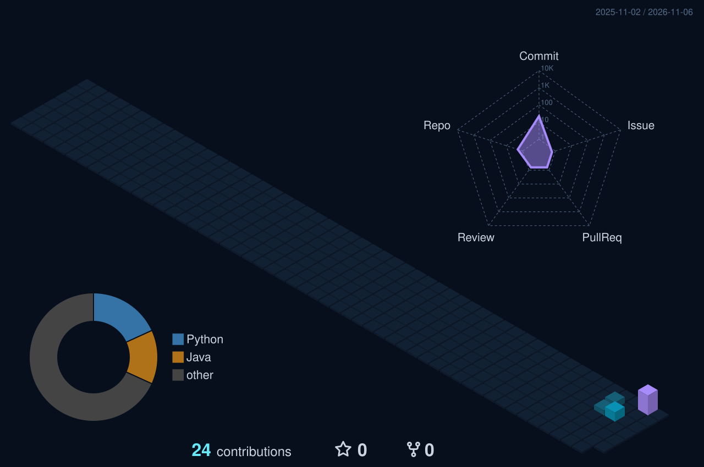

<p align="center">
  
</p>

# FYT / Unity 游戏客户端开发

**C# · Lua · xLua**

关注 Lua UI、AssetBundle 加载与释放，以及客户端性能排查。也会把遇到的实际问题做成小工具。

[代表作品](#projects) · [FYT 技术博客](https://fyt2001.top/) · [全部仓库](https://github.com/fyt2001?tab=repositories)

<a id="projects"></a>

## `01 / projects`

### HomeFlow · iPhone 桌面整理

在电脑上预览和分组 iPhone 桌面的实验性工具。先预览整理方案并保存快照，应用后重新读取布局进行核对。

[查看源码](https://github.com/fyt2001/homeflow-ios) · [打开工具页](https://fyt2001.top/tools/homeflow/)

### J2ME 桌面按键窗口

为自备的 Java ME 游戏 JAR 提供 Windows 桌面按键窗口，支持鼠标点击、键盘映射和方向键长按。使用时需自行准备有权使用的游戏 JAR。

[查看源码与运行说明](https://github.com/fyt2001/j2me-desktop-buttons)

## `02 / stack`

- **游戏客户端** · Unity、C#、Lua、xLua
- **工具与 Web** · Python、FastAPI、Vue 3、JavaScript

## `03 / contribution.city()`

<p align="center">
  
</p>

<p align="center">
  <sub>按 GitHub 可见贡献生成 · 每日自动更新 · <a href="https://github.com/fyt2001/fyt2001/actions/workflows/contribution-city.yml">更新记录</a></sub>
</p>

<details>
<summary><code>$ cat /etc/motd</code> — 开发偏好与隐藏终端</summary>

`explore → build → verify → iterate`

```text
  /\_/\
 ( o.o )  You've found the background daemon.
  > ^ <   curiosity++; coffee.refill();

 // Small tools. Real problems. Repeat.
```

</details>
