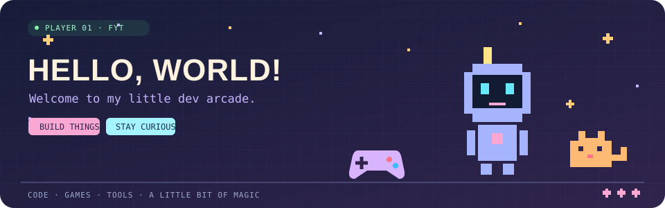

<p align="center">
  
</p>

<h1 align="center">Hi, I'm FYT 👋</h1>

<p align="center">
  🎮 游戏开发与实用工具探索者 · 🛠️ 把想法做成能用的小东西
</p>

<p align="center">
  <a href="https://fyt2001.top/">🏡 逛逛博客</a> &nbsp; · &nbsp;
  <a href="#-项目陈列架">🧩 看看项目</a> &nbsp; · &nbsp;
  <a href="https://github.com/fyt2001?tab=repositories">📦 全部仓库</a>
</p>

---

### 🎒 我的工具背包

<p>
  
</p>

🎮 `游戏开发` &nbsp; 🕹️ `J2ME` &nbsp; 🖥️ `桌面工具` &nbsp; 📱 `设备自动化` &nbsp; 🤖 `AI 辅助开发`

关注 AI 辅助开发、经典游戏复现与设备自动化，分享项目实践与技术笔记。

### 🧩 项目陈列架

| | 项目 | 这里有什么 |
| :---: | --- | --- |
| 📱 | **[HomeFlow](https://github.com/fyt2001/homeflow-ios)** | 在电脑上预览、分组和整理 iPhone 桌面的实验性工具。先保存快照，写入后重新核对。 |
| 🕹️ | **[机甲风暴 · 桌面恢复版](https://github.com/fyt2001/jijiafengbao-v5)** | Java / J2ME 非官方游戏恢复项目，可编译工程 + Windows 桌面操作窗口。原游戏相关权利归原权利人。 |

### 🧪 开发小屋的日常

```text
  💡 一个具体问题
       ↓
  🛠️ 做个小工具 → 🧪 跑一遍验证 → 📝 留下实践笔记
       ↑                                  │
       └──────── 下一个灵感出现了 ──────────┘
```

- 🔍 保持好奇，从具体问题出发。
- 🧰 重视可复现的步骤、实际验证和清晰的使用说明。
- 🤖 使用 AI 辅助探索与实现，区分已验证结果和实验性能力。

<details>
<summary>🐈 点击这里，摸一下路过的小猫</summary>

```text
       /\_/\
      ( o.o )   你发现了一只躲在 README 里的猫！
       > ^ <    今日掉落：好奇心 +1，灵感 +1 ✨
```

写代码累了，就伸个懒腰。☕
</details>

---

<p align="center">
  🌱 慢慢探索，认真做点有意思的东西。
  <br /><br />
  <a href="https://fyt2001.top/">FYT 博客</a> · 欢迎在对应仓库的 Issues 中交流
  <br /><br />
  ✦ &nbsp; 🎮 &nbsp; ✦ &nbsp; 🐈 &nbsp; ✦ &nbsp; ☕ &nbsp; ✦
</p>
