<p align="center">
  
</p>

<p align="center">
  <b>游戏开发 / 实用工具 / 自动化探索</b><br />
  <sub>把好奇心写成代码，把想法做成能用的东西。</sub>
</p>

<p align="center">
  <a href="https://fyt2001.top/"><b>[ BLOG ]</b></a> &nbsp; / &nbsp;
  <a href="#projects"><b>[ PROJECTS ]</b></a> &nbsp; / &nbsp;
  <a href="https://github.com/fyt2001?tab=repositories"><b>[ REPOSITORIES ]</b></a>
</p>

### `01 / stack.load()`


`GAME DEV` · `J2ME` · `DESKTOP TOOLS` · `DEVICE AUTOMATION` · `AI-ASSISTED DEV`

关注 AI 辅助开发、经典游戏复现与设备自动化，分享项目实践与技术笔记。

<a id="projects"></a>

### `02 / projects.list()`

| 模块 | 项目 | 做了什么 |
| --- | --- | --- |
| `DEVICE` | **[HomeFlow](https://github.com/fyt2001/homeflow-ios)** | 在电脑上预览、分组和整理 iPhone 桌面的实验性工具。快照、事务记录、写入后核对。 |
| `GAME` | **[机甲风暴 · 桌面恢复版](https://github.com/fyt2001/jijiafengbao-v5)** | Java / J2ME 非官方游戏恢复项目，可编译工程 + Windows 桌面操作窗口。原游戏相关权利归原权利人。 |

### `03 / developer.config`

```yaml
interests:
  - game_development
  - useful_tools
  - device_automation

workflow: [explore, build, verify, iterate]
ai: "辅助探索与实现"
evidence: "区分已验证结果与实验性能力"
```

<details>
<summary><code>$ cat /etc/motd</code> — 展开隐藏终端</summary>

```text
  /\_/\
 ( o.o )  You've found the background daemon.
  > ^ <   curiosity++; coffee.refill();

 // Small tools. Real problems. Repeat.
```

</details>

<p align="center">
  
</p>

<p align="center">
  <code>stay curious; keep building;</code><br /><br />
  <a href="https://fyt2001.top/">FYT 博客</a> · 欢迎在对应仓库的 Issues 中交流
</p>
